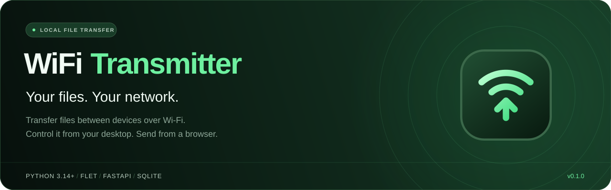
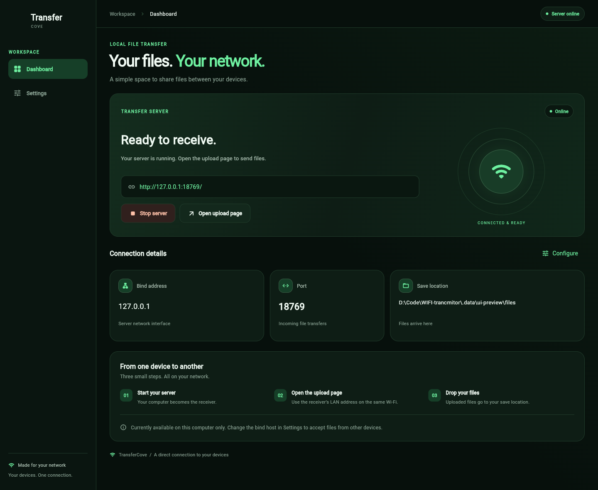
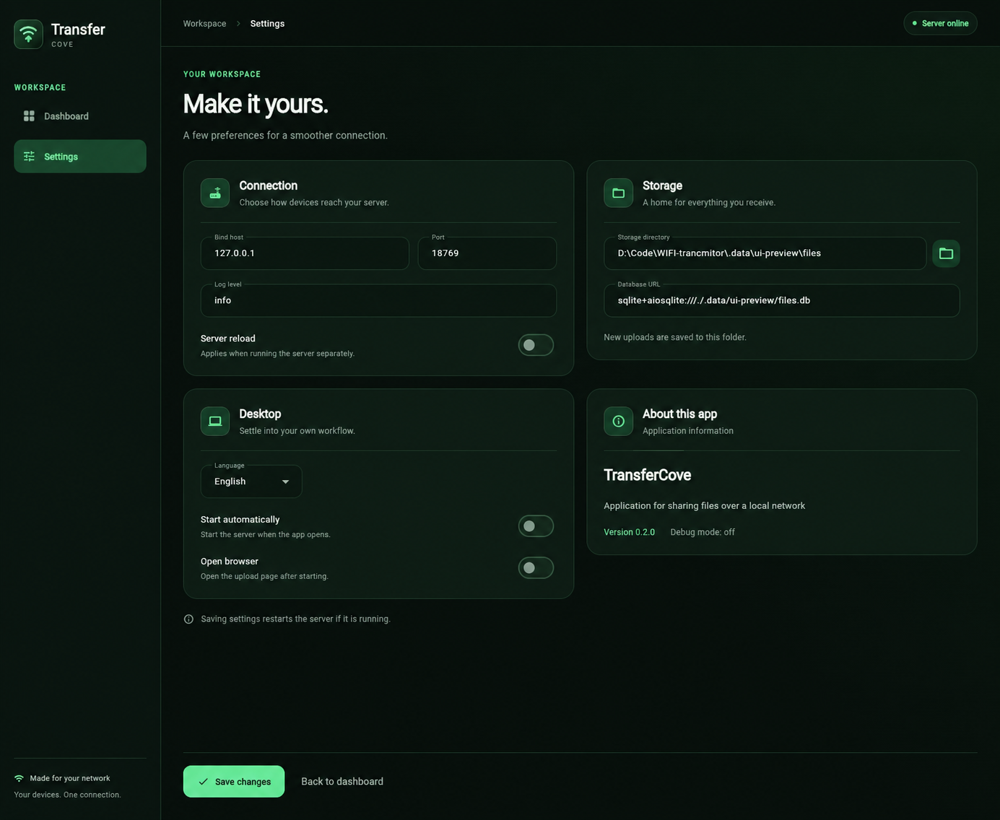
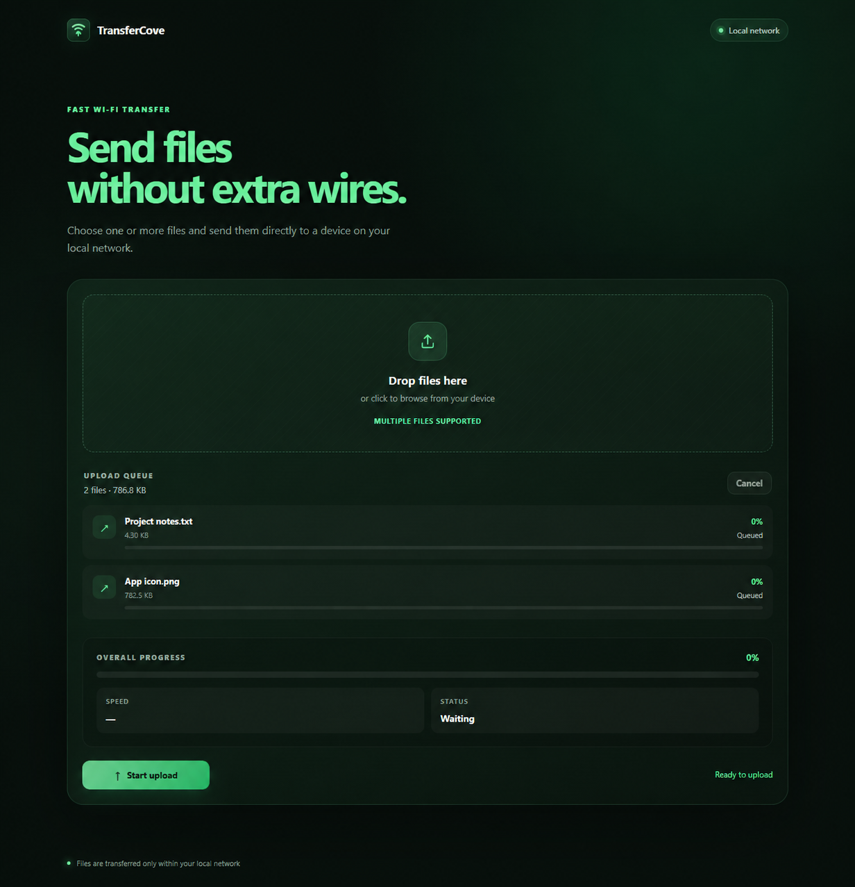

<div align="center">



<br>

**Local file transfers with a desktop control panel and a browser upload page.**

The computer receives files. A phone, tablet, or another computer sends them from a browser.

[Features](#features) · [Preview](#preview) · [Quick start](#quick-start) · [Connect another device](#connection) · [Development](#development)

<br>


</div>

<br>

> [!WARNING]
> **No encryption or authentication:** TransferCove sends files over plain HTTP. Use it only inside a trusted, verified local network. Do not expose the server to the public internet or an untrusted Wi-Fi network.

<a id="features"></a>

## Everything you need for local file transfers

| On the desktop | In the browser | Inside your network |
| :--- | :--- | :--- |
| Start and stop the server with one click | Drag and drop or select multiple files | Upload directly to the receiving computer |
| See server status, address, port, and save location | Track the queue, per-file progress, and total speed | Store files on disk with metadata in SQLite |
| Configure connection, storage, and auto-start behavior | Stop an active upload or cancel the queue | Work without cloud storage |

The dark green interface adapts to the window size. The sending device only needs a browser — there is no app to install on it.

<a id="preview"></a>

## One visual language. Two interfaces.

The desktop app manages the receiver. Any modern browser can act as the sender.

<div align="center">
  <p>
    <a href="docs/images/dashboard.png"></a><br>
    <strong>Dashboard</strong><br><sub>Control the receiver</sub>
  </p>
  <p>
    <a href="docs/images/settings.png"></a><br>
    <strong>Settings</strong><br><sub>Shape your workflow</sub>
  </p>
  <p>
    <a href="docs/images/upload.png"></a><br>
    <strong>Upload page</strong><br><sub>Send from any browser</sub>
  </p>
</div>

<p align="center"><sub>Click any screenshot to open the full-size image. Screenshots were captured in an isolated demo environment with a sample upload queue.</sub></p>

<a id="quick-start"></a>

## Quick start

You need **Python 3.14+** and **Poetry**. Clone or download the project, then open a terminal in its directory.

```bash
poetry install
poetry run python main.py
```

Open **Dashboard → Start server**, then choose **Open upload page**. By default, the upload page is available on the receiving computer at `http://127.0.0.1:8000/`.

Desktop preferences are stored between launches in a separate settings database. Receiving files does not require a history database. On startup, either server attempts to remove old file-history records from an existing local SQLite database; a cleanup failure is logged and does not prevent uploads. New installations do not create `files.db`.

<a id="connection"></a>

## Send from another device

1. Connect the devices to the same local network.
2. In **Settings → Connection**, click **Use current LAN address** and save the settings. The detected IPv4 address is inserted automatically.
3. Start the server. The dashboard shows the shareable address and provides **Copy link** and **QR code** actions.
4. On the other device, scan the QR code or open the copied link.
5. Add files and select **Start upload**. They will appear in the folder configured under **Storage**.

`0.0.0.0` is a server bind address, not an address to enter in a browser. `127.0.0.1` is reachable only from the receiving computer itself. If the connection fails, allow incoming connections to the selected port in the firewall for your private network. If the computer changes networks, use **Use current LAN address** again.

### Available settings

| Section | Controls |
| :--- | :--- |
| Connection | Bind host, automatic LAN address detection, port, and reload for a separately launched server |
| Storage | Destination folder for received files |
| Desktop | Language preference, automatic server start, and browser opening behavior |
| About this app | Application title, description, version, and debug state — read-only information |

Saving settings restarts a running server. The server embedded in the desktop app always runs without reload; the reload option applies when the server is launched separately.

<details>
<summary><strong>Environment variables and `.env`</strong></summary>

The `.env` file is optional. If you do not have one yet, copy [`.env.example`](.env.example):

```powershell
# Windows PowerShell
Copy-Item .env.example .env
```

```bash
# macOS / Linux
cp .env.example .env
```

Important defaults:

```dotenv
UVICORN__HOST=127.0.0.1
UVICORN__PORT=8000
TRANSMITTER__STORAGE_DIR=.data/files
# Legacy history cleanup only; not required for uploads
TRANSMITTER__DATABASE_URL=sqlite+aiosqlite:///./.data/files.db
DESKTOP__AUTO_START=False
DESKTOP__OPEN_BROWSER=True
```

The desktop app uses `.env` as its initial configuration, then loads saved preferences from its SQLite settings database. On Windows builds, Flet stores application data under `%APPDATA%\TransferCove\data`; the first launch after the storage-path change copies data from the old `Your Company\TransferCove` location without overwriting newer files. When running from source without `FLET_APP_STORAGE_DATA`, the desktop settings database is stored under `.flet-data/data/desktop-settings.db`. The standalone web server reads its configuration from `.env` and environment variables.

`APP__*` variables describe the application and are intentionally not editable through the interface.

</details>

<a id="development"></a>

## Development

### Run the web server without the desktop window

```bash
poetry run python -m app.server_start_up
```

Once running, these endpoints are available:

| Endpoint | Purpose |
| :--- | :--- |
| `/` | Browser upload page |
| `/health` | Server health check |
| `/docs` | Interactive FastAPI documentation |
| `POST /v1/files` | Upload one file using the multipart `file` field |

Upload limits are configured in desktop settings and apply to each receiving server: by default one file may be up to 1024 MiB, two uploads may run simultaneously, 512 MiB of free disk space is reserved, and an upload times out after 60 seconds without incoming data. Each request accepts one file; the browser sends multiple selected files sequentially. A multipart request also has 64 KiB of overhead available for headers and boundaries, and part headers are separately limited by the multipart parser.

Free-space checks cover both the system temporary directory and the destination. Checks account for the whole buffered file when it first spills from memory to disk. Each server instance serializes its disk checks, writes, and buffer flushes so its uploads do not spend the same available space concurrently. This is a best-effort reserve: other processes and server instances can still consume disk space. A file is published only after the complete multipart message is received. Rejected, timed-out, and cancelled requests close their temporary files and release their upload slot; cancellation waits for any in-flight disk write to finish before cleanup.

For the standalone server, use the `UPLOAD_LIMITS__MAX_FILE_MIB`, `UPLOAD_LIMITS__MAX_CONCURRENT`, `UPLOAD_LIMITS__RESERVE_MIB`, and `UPLOAD_LIMITS__IDLE_TIMEOUT_SECONDS` variables shown in `.env.example`. Desktop settings are saved separately and take precedence after initial setup.

Upload failures return JSON with a string `detail` field, and the browser shows a corresponding error:

| Status | Meaning |
| :--- | :--- |
| `400` | Malformed or incomplete multipart request, or too many parts |
| `408` | No data arrived within the inactivity timeout |
| `413` | File or request exceeds the size limit |
| `422` | Expected exactly one multipart file field named `file` |
| `429` | All simultaneous upload slots are occupied; retry later |
| `507` | Insufficient disk space, or available space could not be checked |

The timeout measures inactivity, not total upload duration. A slow client that keeps sending data can continue occupying a slot; the receiver can stop the server manually. Transfer-rate throttling, per-client request-rate limits, and a total upload deadline are deferred follow-ups to issue #7 for this personal, manually enabled receiver. They are not enforced by the current limits.

New uploads are saved with their original file names where possible. Unsafe characters are replaced, and duplicate names receive a numbered suffix without replacing existing files. Upload history is not stored in the database. Automatic cleanup deletes old file-history records when the legacy SQLite database is accessible; if cleanup fails, it is retried on the next start. Previously uploaded UUID-named files remain on disk, but their original names cannot be recovered from deleted records. Non-SQLite legacy databases require a manual Alembic migration. On Unix, the destination filesystem must support hard links so that completed uploads can be published without replacing existing files. The list, download, and delete API endpoints are currently placeholders.

### Run the test suite

The project uses `pytest` for unit and integration tests. The suite covers configuration validation, SQLite migrations, settings persistence, file-storage cleanup, the upload service, and the public FastAPI endpoints.

```bash
poetry run pytest
```

The tests create temporary databases and storage directories, so they do not modify `.data/` or the local settings database.

### Automated pull request checks and development builds

GitHub Actions runs dependency review, linting, formatting checks, and the full test suite on Windows and Linux only for pull requests. The tests include launching the standalone upload server, checking its HTTP endpoints, and verifying an uploaded file. The Windows build constrains Flet's packaged Python dependencies to `poetry.lock` and verifies the generated bundle against the lock file.

After the checks pass, CI builds the Windows app and installer, silently installs it in temporary directories as both the current user and all users, and verifies desktop initialization and clean uninstallation. Pull requests also receive dependency review, and Dependabot proposes weekly dependency and workflow updates. Verified installers are available in the workflow run's **Artifacts** section as `TransferCove-test-<commit-sha>`. See [the CI guide](docs/ci.md) for local commands, diagnostics, and required PR checks.

Stable Windows releases use the separate tag-triggered workflow. Publishing a `vX.Y.Z` tag builds and smoke-tests the installer, checks that the tag and application version match `pyproject.toml`, and publishes the installer with a SHA-256 checksum and generated release notes. The packaged Windows app checks GitHub Releases in the background at most once every 24 hours; **Settings → About this app** also has a manual check. Updates are downloaded only from stable releases, verified against the published checksum, and installed only after confirmation. Network failures do not prevent normal app use. See the [release and update guide](docs/ci.md#stable-releases-and-desktop-updates).

### Project structure

```text
app/
├── view/          # Flet desktop screens
├── controller/    # UI, settings, and server coordination
├── server/        # Embedded FastAPI server lifecycle
├── static/        # Browser upload page: HTML, CSS, and JavaScript
├── routes/        # HTTP routes
├── services/      # File uploads and settings operations
├── repository/    # Data access
├── models/        # SQLAlchemy models
└── core/          # Configuration, database, and shared theme
assets/            # Shared SVG, PNG, ICO, and favicon assets
alembic/           # Database migrations
docs/images/       # Banner and interface screenshots
tools/             # Brand asset export tools
main.py            # Flet build entry point
```

### Icon assets and Windows builds

The source mark is [`assets/icon.svg`](assets/icon.svg). The same visual identity is used by the desktop app and the browser page. The repository includes a six-size ICO for Windows, a 1024 × 1024 PNG for Flet builds, SVG and favicon files for browsers, and an Apple Touch Icon for home-screen shortcuts.

After changing the SVG, regenerate the raster assets with:

```bash
poetry run python -m pip install playwright
poetry run python -m playwright install chromium
poetry run python tools/export_brand.py
```

Build the Windows desktop package on Windows:

```bash
poetry run flet build windows --yes --build-version 0.3.2
```

Flet reads the application icon from `assets/icon.png`; the build entry point, artifact name, and local-data exclusions are configured in `pyproject.toml`. A Windows build also requires Flutter and the C++ desktop tools from Visual Studio. See the [Flet Windows publishing guide](https://flet.dev/docs/publish/windows/) for the platform prerequisites.

### Windows installer and license notices

The repository includes an Inno Setup script at [`installer/windows/TransferCove.iss`](installer/windows/TransferCove.iss). The build script reads the version from `pyproject.toml` and passes it to Inno Setup. After building the Flet application, run these commands from PowerShell to create the installer under `dist/installer/`:

```text
poetry install --with dev,build
poetry run flet build windows --yes --python-version 3.14 --build-version (poetry version --short)
./.github/scripts/build-installer.ps1
```

Opening the Inno Setup script directly also works: it reads the version from the built executable when no version override is supplied.

The installer displays the MIT license, installs [`LICENSE`](LICENSE) and [`THIRD-PARTY-NOTICES.txt`](THIRD-PARTY-NOTICES.txt), and preserves the dependency license metadata shipped in the Flet bundle. Release installers are currently unsigned; signing remains outside the repository so certificates and passwords are never committed. If dependency versions change during a rebuild, update `THIRD-PARTY-NOTICES.txt` from the final bundle before publishing the installer.

### Current project boundaries

- File uploads to the receiving computer are implemented. Listing, downloading, and deleting files through the API remain placeholders.
- Full localization is not connected yet: the interface is currently English, while the language selector stores a preference for future localization.
- The server uses plain HTTP without authentication. The application is intended for a trusted local network; public deployment requires separate access control and HTTPS configuration.

<a id="license"></a>

## License

TransferCove is open-source software licensed under the [MIT License](LICENSE).
You may use, modify, and redistribute the project, including in commercial products,
provided that the copyright and license notices are preserved.
This license covers the project code and original assets in this repository; third-party
dependencies remain under their own licenses.

<br>

<div align="center">


**TransferCove**<br>
<sub>Your devices. One connection.</sub>

</div>
