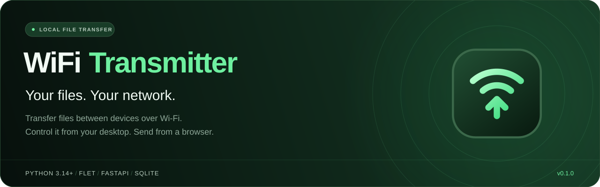
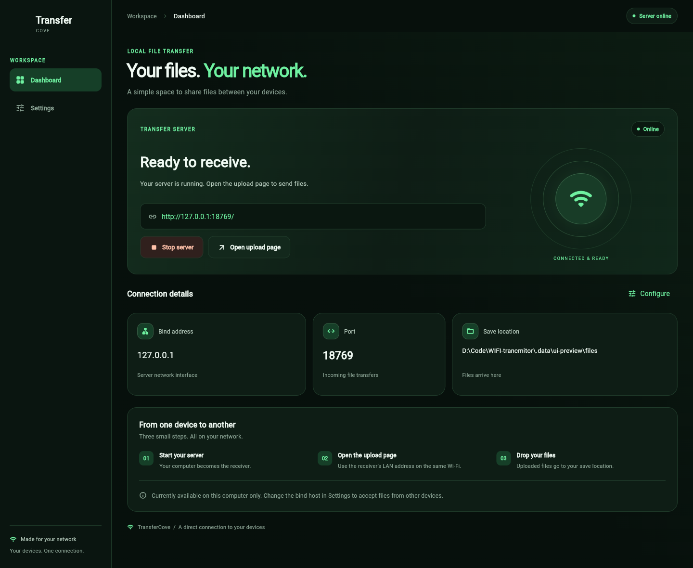
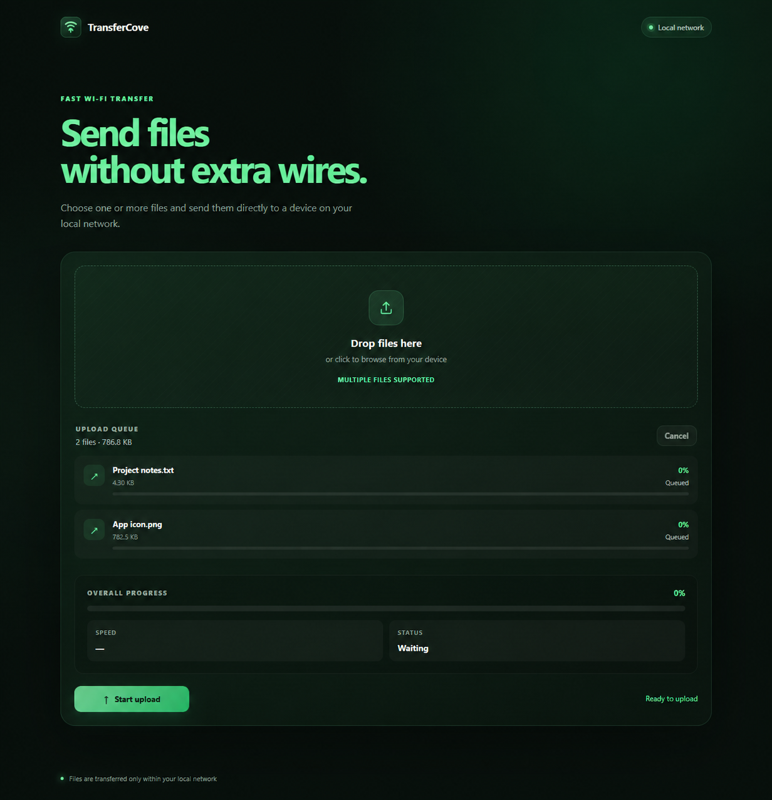

# TransferCove



TransferCove receives files from phones, tablets, and other computers over your local network. The receiving computer runs the desktop app. Senders open the upload page in their browser using a link or QR code.

[Download for Windows](https://github.com/AlexZha-dev/transfercove/releases/latest) · [Send files](#send-files) · [Run from source](#run-from-source) · [Build the Windows installer](#build-the-windows-installer)

> [!WARNING]
> TransferCove uses plain HTTP without authentication. Any device that can reach the server can upload files. Use TransferCove only on a trusted local network and keep the server off the public internet.

## Install on Windows

1. Open the [latest GitHub Release](https://github.com/AlexZha-dev/transfercove/releases/latest).
2. Under **Assets**, download the `TransferCove-Setup-X.Y.Z.exe` file for that release.
3. Run the installer and open **TransferCove** from the Start menu.

The installer is unsigned and targets x64-compatible systems running Windows 10 or later. The installed app includes its runtime. To check for stable updates, open **Settings → About this app → Check for updates**. TransferCove verifies the downloaded installer's SHA-256 checksum and asks before launching Setup.

## Send files

1. Connect the receiving computer and sending device to the same trusted local network.
2. Open TransferCove and acknowledge the first-run security notice. If the dashboard shows `127.0.0.1` and you are sending from another device, select **Settings → Connection → Use current LAN address** and save.
3. Select **Start server** on the dashboard.
4. Select **Show QR code** or **Copy link**, then open that address on the sending device. To upload from the receiving computer, select **Open upload page**.
5. Add files and select **Start upload**. The browser shows per-file progress and sends the queue one file at a time.
6. Find the received files in the directory shown on the dashboard. Change it under **Settings → Storage**. Select **Stop server** when finished.

TransferCove keeps original file names where possible, replaces unsafe characters, and adds a numeric suffix to duplicate names. Received files stay on disk without an upload history.

### Connection and storage defaults

| Setting | Default behavior |
| --- | --- |
| Desktop bind host | On first launch, TransferCove tries to select a private LAN IPv4 address and falls back to `127.0.0.1` if detection fails. |
| Port | `8000` |
| Storage directory | `.data/files` under the project directory when running from source, or under the Flet application data directory when running the Windows bundle. |
| Server startup | Start manually from the dashboard. Automatic startup is available in desktop settings. |

If the receiver changes networks, use **Settings → Connection → Use current LAN address** and save. The loopback address `127.0.0.1` works only on the receiving computer. If another device cannot connect, check that the receiving computer's firewall allows connections to the configured port on the private network.

### Languages

The desktop app and upload page support English, Spanish, Brazilian Portuguese, German, French, Russian, and Ukrainian. The desktop app saves its language in settings. The upload page starts with the browser's preferred supported language and remembers its own selection.

## Preview

| Desktop dashboard | Browser upload page |
| --- | --- |
| [](docs/images/dashboard.png) | [](docs/images/upload.png) |

[Desktop settings screenshot](docs/images/settings.png) · [Mobile upload screenshot](docs/images/upload-mobile.png)

## Run from source

Use Python 3.14 and Poetry. From a clone of the repository, run:

```text
poetry install --with dev
poetry run python main.py
```

[.env.example](.env.example) documents optional environment variables. Copy it to `.env` to provide initial desktop defaults. To let the desktop detect your LAN address, leave `UVICORN__HOST` unset. To restrict a fresh desktop configuration to the receiving computer, set `UVICORN__HOST=127.0.0.1` before the first launch.

The desktop app persists its preferences in SQLite. A source run stores them at `.flet-data/data/desktop-settings.db` by default. Saved connection, storage, upload limits, and desktop preferences take precedence after setup. Saving a language-only change leaves a running server active. Other settings changes restart it.

### Standalone server

Run the same upload page and API without opening the desktop:

```text
poetry run python -m app.server_start_up
```

The standalone server reads environment variables and `.env` independently of desktop settings. With the defaults, open `http://127.0.0.1:8000/` for uploads, `/health` for the health check, or `/docs` for the interactive FastAPI reference. To accept connections from another device, set `UVICORN__HOST` to the receiver's private LAN address and restart the server.

`POST /v1/files` accepts one multipart file field named `file`. The file listing, download, and delete routes are placeholders.

| Upload limit | Default |
| --- | --- |
| Maximum file size | 1024 MiB |
| Concurrent uploads per server | 2 |
| Minimum free disk space reserve | 512 MiB |
| Timeout without incoming data | 60 seconds |

Change these limits in **Settings → Upload limits** for the desktop server or via the `UPLOAD_LIMITS__*` variables in [.env.example](.env.example) for the standalone server. On Unix, the destination filesystem must support hard links to publish completed uploads without replacing existing files.

New installations have no file-history database. When a server starts, it attempts to remove obsolete history records from an existing legacy SQLite database while leaving received files on disk. Files saved under UUID names stay under those names.

## Development

```text
poetry check --lock
poetry run python -m app.core.localization
poetry run ruff check app tests tools main.py alembic
poetry run ruff format --check app tests tools main.py alembic
poetry run pytest
```

- Desktop entry point and views live in [`main.py`](main.py) and [`app/view/`](app/view/).
- The browser interface lives in [`app/static/`](app/static/) and the HTTP endpoints in [`app/routes/`](app/routes/).
- Language catalogs live in [`app/locales/`](app/locales/). See the [translation guide](docs/translations.md).
- GitHub Actions runs tests and lint on Windows and Ubuntu for pull requests. The Windows job also builds and smoke-tests a development installer. See the [CI guide](docs/ci.md).

### Build the Windows installer

Build on Windows with the Visual Studio **Desktop development with C++** workload and Inno Setup 6.3 or newer. See the [Flet Windows prerequisites](https://flet.dev/docs/publish/windows/) and the [local build and verification commands](docs/ci.md#local-verification).

The Flet bundle is written to `build/windows/`. The installer script reads the version from [`pyproject.toml`](pyproject.toml), verifies that the bundle matches, and writes `TransferCove-Setup-X.Y.Z.exe` and its `.exe.sha256` file under `dist/installer/`. See the [release guide](docs/ci.md#stable-releases-and-desktop-updates) for publishing.

## License

TransferCove is available under the [MIT License](LICENSE). Packaged components retain their upstream licenses and attributions. See the [third-party notices](THIRD-PARTY-NOTICES.txt).
